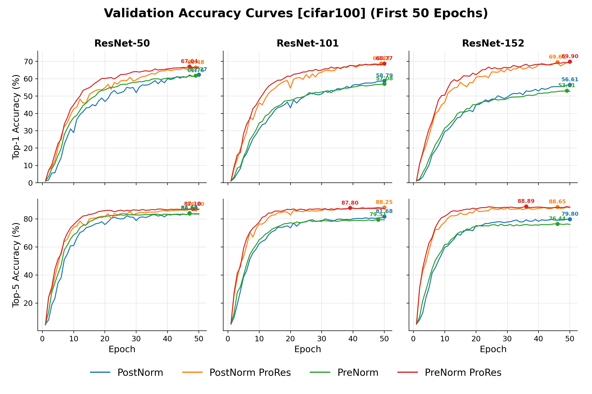
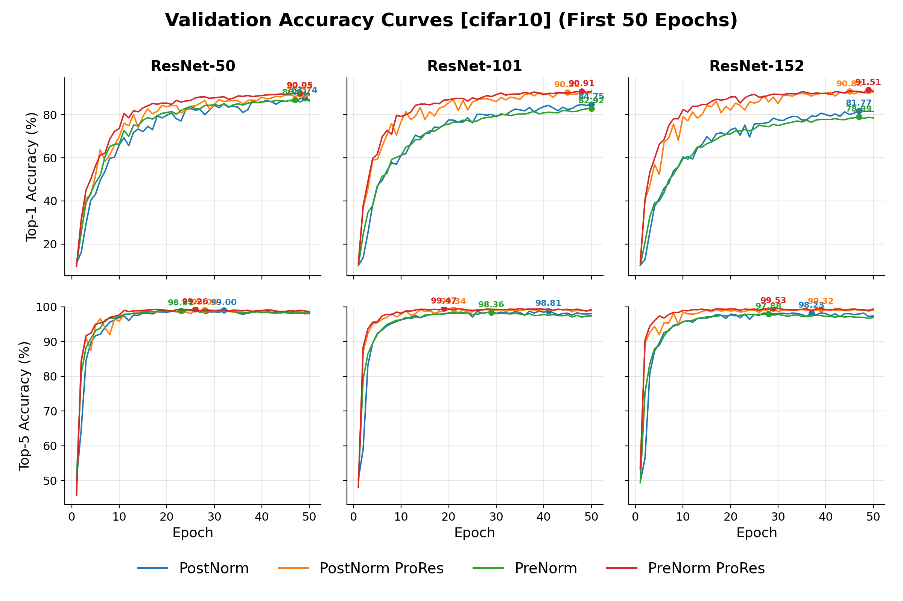

# ProRes on ResNets: normalization and residual scaling

This repository contains the reference implementation and results for a controlled study of **ProRes** (progressive residual scaling) in ResNets. The experiment crosses three depths (ResNet-50, 101, 152), two normalization layouts (PostNorm, PreNorm), and ProRes on/off, on three datasets: ImageNet-100, CIFAR-100, and CIFAR-10. That is 12 runs per dataset, 36 in total.

## Results

The tables report epoch-50 accuracy and the gain from ProRes. Full per-run summaries, including best-within-50 values, are in `results/<dataset>/results_summary.csv`.

### ImageNet-100


| Depth | Norm | Top-1 off | Top-1 on | Gain | Top-5 off | Top-5 on |
|---|---|---:|---:|---:|---:|---:|
| R50 | PostNorm | 78.28 | 79.30 | +1.02 | 93.98 | 94.02 |
| R50 | PreNorm | 77.82 | 78.98 | +1.16 | 93.52 | 94.18 |
| R101 | PostNorm | 78.20 | 80.08 | +1.88 | 94.08 | 94.98 |
| R101 | PreNorm | 76.66 | 80.44 | +3.78 | 93.08 | 94.40 |
| R152 | PostNorm | 79.72 | 81.24 | +1.52 | 94.62 | 94.60 |
| R152 | PreNorm | 75.28 | 81.04 | +5.76 | 91.94 | 94.72 |

ProRes improves all six depth/normalization pairs at epoch 50, by +1.02 to +5.76 points. Without ProRes, PreNorm falls with depth (77.82, 76.66, 75.28), while PostNorm is flatter. The spread across the four variants grows with depth: 1.48, 3.78, and 5.96 points for R50, R101, and R152.

### CIFAR-100



| Depth | Norm | Top-1 off | Top-1 on | Gain | Top-5 off | Top-5 on |
|---|---|---:|---:|---:|---:|---:|
| R50 | PostNorm | 62.37 | 66.37 | +4.00 | 83.72 | 86.56 |
| R50 | PreNorm | 61.36 | 66.78 | +5.42 | 83.32 | 86.96 |
| R101 | PostNorm | 58.79 | 68.83 | +10.04 | 81.68 | 88.25 |
| R101 | PreNorm | 57.08 | 68.77 | +11.69 | 79.32 | 87.37 |
| R152 | PostNorm | 56.61 | 68.95 | +12.34 | 79.80 | 88.10 |
| R152 | PreNorm | 52.75 | 69.90 | +17.15 | 76.07 | 88.36 |

The same ordering is much stronger on CIFAR-100. ProRes gains range from +4.00 to +17.15 points. PreNorm without ProRes falls from 61.36 (R50) to 57.08 (R101) and 52.75 (R152); with ProRes, R152 PreNorm reaches 69.90, essentially matching PostNorm at 68.95. The spread across variants grows from 5.42 to 11.75 and 17.15 points with depth.

### CIFAR-10



| Depth | Norm | Top-1 off | Top-1 on | Gain | Top-5 off | Top-5 on |
|---|---|---:|---:|---:|---:|---:|
| R50 | PostNorm | 86.94 | 89.19 | +2.25 | 97.97 | 98.42 |
| R50 | PreNorm | 86.41 | 89.62 | +3.21 | 98.24 | 98.61 |
| R101 | PostNorm | 84.75 | 90.20 | +5.45 | 98.00 | 98.87 |
| R101 | PreNorm | 82.92 | 90.86 | +7.94 | 97.38 | 99.16 |
| R152 | PostNorm | 81.50 | 90.67 | +9.17 | 97.34 | 99.07 |
| R152 | PreNorm | 78.54 | 90.95 | +12.41 | 96.91 | 99.30 |

CIFAR-10 shows the same pattern at higher absolute accuracy. ProRes gains range from +2.25 to +12.41 points. PreNorm without ProRes falls from 86.41 (R50) to 82.92 (R101) and 78.54 (R152); with ProRes, R152 PreNorm reaches 90.95. The spread across variants grows from 3.21 to 7.94 and 12.41 points with depth.

## What the results show across datasets

- ProRes improves top-1 accuracy at epoch 50 in all 18 depth/normalization pairs across the three datasets.
- The gain grows with depth in the pre-norm condition on every dataset. CIFAR-100 shows the largest gains overall (+17.15 for R152 PreNorm).
- Without ProRes, PreNorm degrades with depth on all three datasets, while PostNorm degrades less steeply.
- With ProRes, deeper models reach similar accuracy across the two normalization layouts. The spread across the four variants still grows with depth.
- The gain is generally largest early in training and narrows by epoch 50, but it remains positive at 50. Many curves are still rising at 50, so the figure reflects early optimization rather than final accuracy.
- Only one seed is used per configuration. Differences of a few tenths of a point should not be over-interpreted.

## ProRes in one equation

For a Pre-LN Transformer layer, ProRes computes

```
x_(l+1) = x_l + alpha(l,t) * F(LayerNorm(x_l))
alpha(l,t) = min(t / (T * l), 1)
```

where `l` is the layer index and `t` is the training step. Deeper layers receive a longer warmup. In a ResNet, `F` is the residual branch (convolution, batch normalization, and ReLU). The implementation is in `models/prores.py`; the reference runs use `T = 1` and update `alpha` at the start of each epoch.

## Repository layout

```
.
├── assets/                  # README figures
├── configs/
│   ├── configs.yaml         # default ImageNet-100 example (R50 PostNorm)
│   ├── imagenet100/         # 12 ImageNet-100 configurations
│   ├── cifar100/            # 12 CIFAR-100 configurations
│   └── cifar10/             # 12 CIFAR-10 configurations
├── data/                    # data-loading package (datasets not included)
├── models/                  # ResNet and ProRes blocks
├── results/
│   ├── imagenet100/         # logs, metrics.csv, results_summary.csv
│   ├── cifar100/
│   └── cifar10/
├── utils/
├── train.py
├── download_imagenet100.py
└── requirements.txt
```

## Setup

```bash
pip install -r requirements.txt
```

## Data

ImageNet-100 is available from Kaggle:

https://www.kaggle.com/datasets/ambityga/imagenet100

Arrange it as:

```
data/imagenet100/train.X1..X4/<class>/...
data/imagenet100/val.X/<class>/...
```

The loader in `data/dataset.py` also accepts the older layout with `train.X*` and `val.X` directly under `data.root`. The `data/` directory in this repository contains only the loader.

CIFAR-10 and CIFAR-100 are downloaded automatically by `torchvision` into `data/` when their configurations are used.

## Running

```bash
# ImageNet-100
cp configs/imagenet100/resnet50_postnorm.yaml configs/configs.yaml
python train.py --amp

# CIFAR-100
cp configs/cifar100/resnet50_postnorm.yaml configs/configs.yaml
python train.py --amp

# CIFAR-10
cp configs/cifar10/resnet50_postnorm.yaml configs/configs.yaml
python train.py --amp
```

To run another configuration, copy the corresponding YAML from the dataset-specific directory to `configs/configs.yaml`. All configurations assume `data.root: ./data`; edit it if the datasets live elsewhere.

## Reproducing the results

The reference runs used 100 epochs for every dataset. The figures and tables use the first 50. `results/<dataset>/metrics.csv` contains all 100 epochs; filter it to `epoch <= 50` to recreate the plotted window. `results/<dataset>/results_summary.csv` contains the exact epoch-50 values and the first epoch at which each run reaches its best top-1 accuracy within the window. The raw logs are in `results/<dataset>/logs/`.

No checkpoints or datasets are included in this repository.

## Notes

- The ProRes warmup length is tied to depth: the number of blocks is 16, 33, and 50 for ResNet-50, 101, and 152. Depth and schedule length are therefore confounded in the cross-depth comparison.
- Only one seed is used per configuration.

## References

- Chen et al., *Progressive Residual Warmup for Language Model Pretraining* (2026), [arXiv:2603.05369](https://arxiv.org/abs/2603.05369).
- He et al., *Deep Residual Learning for Image Recognition* (2016), [arXiv:1512.03385](https://arxiv.org/abs/1512.03385).
