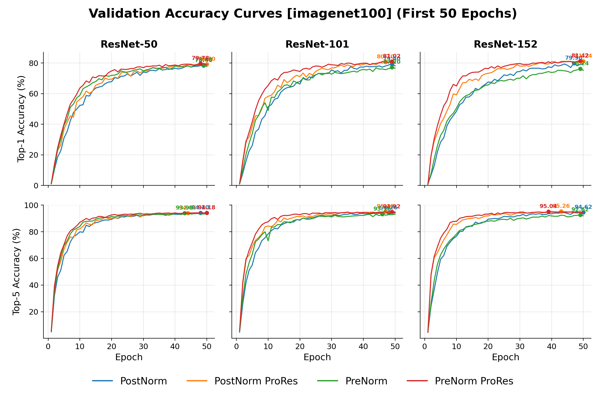

# ProRes on ResNets: normalization and residual scaling on ImageNet-100

This repository contains the reference implementation and results for a controlled study of **ProRes** (progressive residual scaling) in ResNets. The experiment crosses three depths, two normalization layouts, and ProRes on/off: twelve runs in total.

## Results

Validation accuracy over the first 50 epochs:



Epoch-50 results and the best top-1 accuracy within the first 50 epochs:

| Depth | Norm | ProRes | Top-1 @ 50 | Top-5 @ 50 | Best top-1 (epoch) |
|---|---|:---:|---:|---:|---:|
| R50 | PostNorm | off | 78.28 | 93.98 | 78.46 (49) |
| R50 | PostNorm | on | 79.30 | 94.02 | 79.30 (50) |
| R50 | PreNorm | off | 77.82 | 93.52 | 78.68 (49) |
| R50 | PreNorm | on | 78.98 | 94.18 | 79.78 (48) |
| R101 | PostNorm | off | 78.20 | 94.08 | 79.40 (49) |
| R101 | PostNorm | on | 80.08 | 94.98 | 80.70 (47) |
| R101 | PreNorm | off | 76.66 | 93.08 | 77.20 (49) |
| R101 | PreNorm | on | 80.44 | 94.40 | 81.02 (49) |
| R152 | PostNorm | off | 79.72 | 94.62 | 79.90 (47) |
| R152 | PostNorm | on | 81.24 | 94.60 | 81.24 (50) |
| R152 | PreNorm | off | 75.28 | 91.94 | 76.24 (49) |
| R152 | PreNorm | on | 81.04 | 94.72 | 81.42 (49) |

### What the results show

- ProRes improves top-1 accuracy at epoch 50 in all six depth/normalization pairs. The gains range from +1.02 (R50 PostNorm) to +5.76 (R152 PreNorm).
- Without ProRes, PreNorm degrades with depth: 77.82 (R50), 76.66 (R101), and 75.28 (R152). PostNorm is flatter.
- With ProRes, deeper models perform better, and the spread across the four variants grows with depth: 1.48 (R50), 3.78 (R101), and 5.96 (R152).
- The ProRes gain is largest early in training and narrows by epoch 50, but it remains positive at 50, especially for R101/R152 PreNorm. The benefit is front-loaded rather than purely transient.
- The curves are still rising at epoch 50. The figure measures early optimization, not final accuracy.
- Only one seed is used per configuration; differences of a few tenths of a point should not be over-interpreted.

## ProRes in one equation

For a Pre-LN Transformer layer, ProRes computes

```
x_(l+1) = x_l + alpha(l,t) * F(LayerNorm(x_l))
alpha(l,t) = min(t / (T * l), 1)
```

where `l` is the layer index and `t` is the training step. Deeper layers receive a longer warmup. In a ResNet, `F` is the residual branch (convolution, batch normalization, and ReLU). The implementation is in `models/prores.py`; the reference runs use `T = 1` and update `alpha` at the start of each epoch.

## Repository layout

```
.
├── assets/                  # README figure
├── configs/
│   ├── configs.yaml         # default example (R50 PostNorm)
│   └── imagenet100/         # the 12 reference configurations
├── data/                    # data-loading package (dataset not included)
├── models/                  # ResNet and ProRes blocks
├── results/
│   ├── logs/                # 12 reference training logs
│   ├── metrics.csv          # per-epoch train/val metrics, 100 epochs per run
│   └── results_summary.csv  # epoch-50 and best-within-50 summary
├── utils/
├── train.py
├── download_imagenet100.py
└── requirements.txt
```

## Setup

```bash
pip install -r requirements.txt
```

## Data

The experiments use the ImageNet-100 split from Kaggle:

https://www.kaggle.com/datasets/ambityga/imagenet100

Arrange it as:

```
data/imagenet100/train.X1..X4/<class>/...
data/imagenet100/val.X/<class>/...
```

The loader in `data/dataset.py` also accepts the older layout with `train.X*` and `val.X` directly under `data.root`. The `data/` directory in this repository contains only the loader, not the images.

## Running

```bash
cp configs/imagenet100/resnet50_postnorm.yaml configs/configs.yaml
python train.py --amp
```

To run another configuration, copy the corresponding YAML from `configs/imagenet100/` to `configs/configs.yaml`. The configurations assume `data.root: ./data`; edit it if the dataset lives elsewhere.

## Reproducing the results

The reference runs used 100 epochs. The figure and the table use the first 50. `results/metrics.csv` contains all 100 epochs; filter it to `epoch <= 50` to recreate the plotted window. `results/results_summary.csv` contains the exact epoch-50 values and the first epoch at which each run reaches its best top-1 accuracy within the window. The raw logs are in `results/logs/`.

No checkpoints or ImageNet-100 images are included in this repository.

## References

- Chen et al., *Progressive Residual Warmup for Language Model Pretraining* (2026), [arXiv:2603.05369](https://arxiv.org/abs/2603.05369).
- He et al., *Deep Residual Learning for Image Recognition* (2016), [arXiv:1512.03385](https://arxiv.org/abs/1512.03385).
